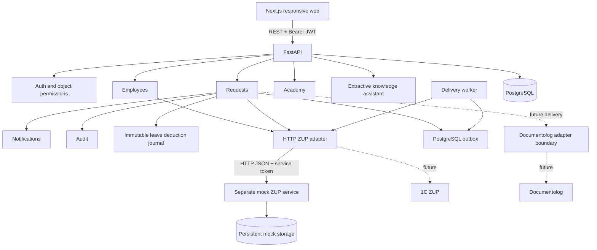

# Архитектура

Frontend получает данные из backend. Кадровые профили впервые загружаются по HTTP из отдельного mock seed-командой; запросы пользователя читают сохранённую read-only проекцию. Актуальный баланс и расчёт запрашиваются из mock по внешнему идентификатору сотрудника. Источник хранит собственные документы и остатки. Backend вычитает из текущего ответа только те локальные списания, ключей которых ещё нет в согласованном списке `applied_commands`. Это устраняет двойной вычет после потери квитанции. Контракт ограниченного HTTP-расширения описан в zup-integration.md. Documentolog представлен границей интерфейса, без реальной отправки.

Backend разделён на доменные router/service-модули и общую инфраструктуру. Сессия БД на запрос. Маршрут заявки — `submitted → manager_approved → approved`, с финальным `rejected` на любом этапе. Финальное одобрение, запись списания, история, уведомление и аудит входят в одну транзакцию. UPDATE с ожидаемой version и текущим статусом защищает этап от повтора, уникальность `request_id` — от второго списания, а PostgreSQL-блокировка строки сотрудника сериализует одобрения разных заявок по одному балансу. Миграции создают схему явно, без импорта ORM-моделей. create_all на старте не используется.

Команда передачи отпуска создаётся в одной транзакции с финальным решением. Первая попытка выполняется после commit, затем отдельный worker повторяет сохранённую команду с постоянным UUID-ключом; ручной повтор доступен HR. Расчёт и его версия сохраняются в заявке. При недоступности чтения источника нет скрытого fallback; при сбое записи outbox сохраняет pending/error независимо от бизнес-статуса approved.

В MVP уведомления хранятся в той же БД и читаются по HTTP. Их внешняя доставка пока не реализована. PostgreSQL + pgvector и генеративный RAG вводятся после оценки качества; текущий помощник использует разрешённые фрагменты демонстрационной базы. Его mode прозрачно указан в API/UI.
